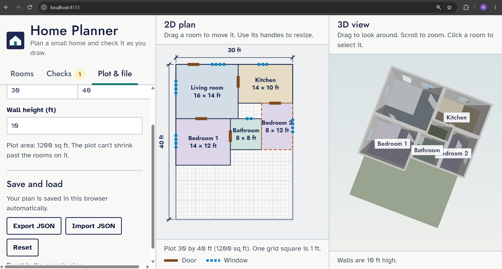
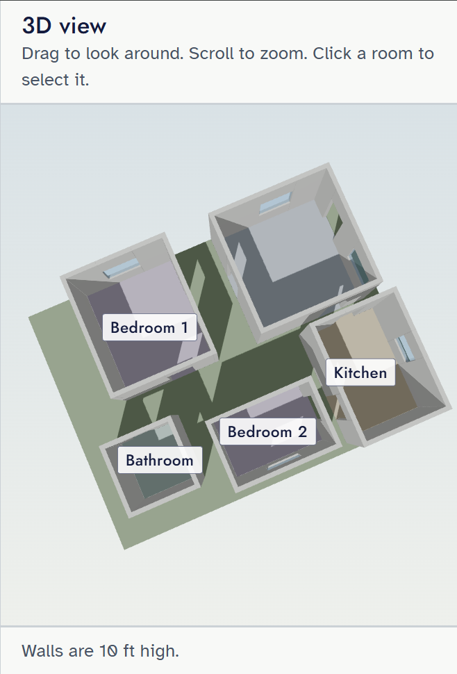
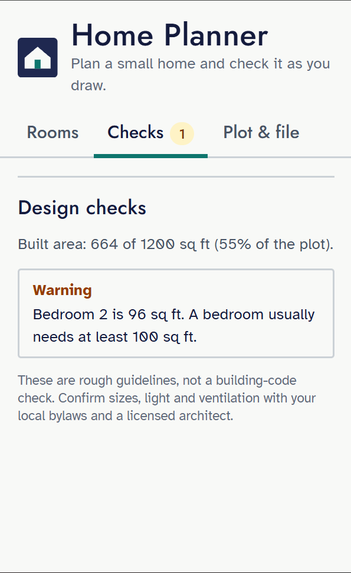

# Home Planner

Plan a small home in 2D and see it in 3D. Drag rooms around a plot, add doors and windows, and get design feedback as you go. Everything runs in the browser.

Live demo: https://YOUR-APP.vercel.app



## Features

- **Synchronized 2D and 3D views.** Edit the plan in 2D and watch the 3D model update live.
- **Rooms:** add, move, resize (snapped to whole feet), rename, retype and delete, or type exact sizes and positions.
- **Doors and windows** on any wall, drawn as real openings in the 3D walls.
- **Design checks:** overlapping rooms, rooms that are too small, missing doors or windows, windows that face another room, and rooms without light or ventilation.
- **Save and load:** autosaves in the browser, with JSON export and import. Imported files are validated.
- **Keyboard and screen reader friendly controls**, with a tabbed sidebar.




## Run it locally

Requires Node 20 or newer.

```bash
git clone https://github.com/YOUR-USERNAME/home-planner.git
cd home-planner
npm install
npm run dev
```

| Command | What it does |
|---|---|
| `npm run dev` | Start the dev server |
| `npm test` | Run the unit tests |
| `npm run build` | Type-check and build for production |
| `npm run lint` | Lint the code |

## How it works

- **One source of truth.** A `Plan` (plot, rooms, openings) lives in a Zustand store. The 2D editor, the 3D scene, the room list and the checks are all just views of that data.
- **Pure model code.** Geometry, validation and design rules are plain functions in `src/model`, covered by unit tests (Vitest).
- **Validation at the boundary.** Anything that comes from outside, such as an imported file or saved browser data, is checked with a Zod schema before it can enter the store. Older saved plans are upgraded, and invalid data falls back safely instead of crashing the app.
- **3D walls without CSG.** Each wall is built from boxes around its openings: solid sections, a lintel above each opening, and a sill and glass pane for windows.
- **Snapping and constraints.** Rooms and openings snap to a grid and stay inside the plot and on their walls, including after a room is resized.

## Tech stack

React, TypeScript, Vite, Three.js (React Three Fiber), react-konva, Zustand, Zod, Tailwind CSS, Vitest.

## Limitations

- The design checks use rough guideline values, not building-code rules. Confirm sizes, light and ventilation with your local bylaws and a licensed architect.
- One floor and rectangular rooms only.
- Rooms are positioned with the mouse or number fields, not with the keyboard directly. The number fields are the accessible alternative.

## Possible next steps

Multiple floors, stairs, furniture, imperial and metric units, and an undo history.

## License

MIT